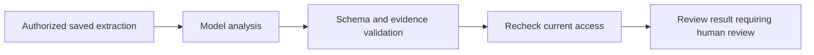

# Learning: the first LangGraph workflow

SuitsFlow now has an executable LangGraph contract-review foundation. It is an
internal Python service tested with fake model responses, not a deployed AI feature.
It does not call Bedrock, S3 or any other remote provider in its tests. There is no
review API endpoint or UI action yet, and no production fake-model fallback.

## The graph



LangGraph supplies the state transitions. Our service supplies the authorized
source and current-access callbacks. The model receives only the document text
and fixed instructions. It never selects the tenant, resource IDs, database query,
storage location, tools or next graph node.

This uses the library's [StateGraph API](https://docs.langchain.com/oss/python/langgraph/graph-api):
nodes return partial state updates, edges define execution order, and compilation
creates an invocable graph. The current workflow has four nodes and no planning loop.

## Follow the boundaries

`ReviewService.review(principal, document_id, version_id, model)` reloads current
membership and confirms the document is a contract. It loads an existing saved
extraction through `SavedExtractions.get`, preserving tenant scoping, file clearance,
object verification, and source provenance. It releases read transactions before
the model runs. Inputs over 20,000 Unicode characters or blank inputs are rejected;
we do not silently truncate a contract and present it as a complete review.

The injected `ReviewModel` protocol is the seam for a future Bedrock adapter. Tests
provide fake implementations. The adapter must be asynchronous and support
cancellation; each attempt has a cooperative 30-second timeout. There are at most
two attempts, only for explicitly classified transient provider failures/timeouts.
Authorization and validation failures are not retried. Access and clearance are
rechecked before each provider attempt and before returning the validated result.

## What validation proves

The model returns JSON containing up to 20 findings. Each includes a category,
severity, description, confidence, quotation, and start/end offsets. Strict schemas
reject unexpected fields, invalid severities, out-of-range confidence and malformed
values. Output is limited to 32,000 characters before JSON parsing.

For every quotation, deterministic code checks:

```python
source.text[finding.start:finding.end] == finding.evidence
```

Offsets count Python Unicode code points, not UTF-8 bytes or JavaScript UTF-16 units.
This matters when a contract contains currency symbols, emoji or other Unicode text.
The server attaches the document, revision and extraction IDs and checksums from
the authorized source; model-generated resource IDs are rejected as extra fields.

These checks prove the quotation occurs at the specified location. They do not
prove that the risk description follows from the quotation, that a review is
complete, or that a confidence score is calibrated. Every result requires human
review, including an empty findings array. Semantic grounding needs evaluations
with reviewed examples before production use.

## Data handling and current limits

Document instructions are treated as untrusted data. The graph exposes no tools or
side effects. This limits what a prompt injection can do, but does not establish
that a future model will ignore malicious text. Prompt-injection evaluation remains
required when a real adapter is introduced.

External LangSmith tracing is explicitly disabled inside the graph, even when an
ambient tracing environment variable is enabled. No checkpoint store, persistent
review records, audit events, approval/resume flow or external tracing is configured.
Graph state exists in memory for one invocation. Process interruption loses it.
No review is yet exposed to users or persisted as an audited business record.

## Run the focused tests

```sh
uv run pytest tests/test_review_graph.py
```

Tests exercise the actual compiled graph with fake models, malformed and fabricated
evidence, bounded retries, revoked access, Unicode offsets and disabled tracing.
Service adapter tests mock repositories; the existing integration suite separately
tests the tenant-scoped extraction and membership services. This is not a real-model
quality evaluation or an end-to-end production deployment test.

Next: durable review requests/results with audited lifecycle and background execution,
then a provider adapter and evaluation set, then API/UI integration. Policy Q&A,
contract-expiration lookup, retrieval, MCP tools and approval workflows remain planned.
